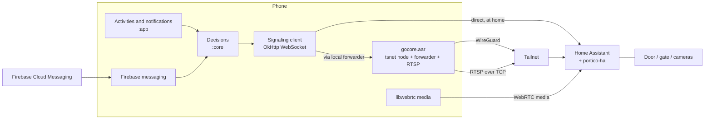

# Architecture overview

This page shows how the pieces of Portico app fit together: the three code modules, the link to Home Assistant, how calls and push reach the phone, and where the tailnet comes in.

## Modules

| Module | Language | What it holds |
| :--- | :--- | :--- |
| `:core` (`core/`) | Kotlin/JVM, no `android.*` imports | The decisions: the Home Assistant link (`ha/`), enrolment and login (`enroll/`, `auth/`), the push decision (`push/`), answering and placing calls (`call/`), ring plans (`ring/`), Home's model, live video plans (`live/`), pause, stay-connected and roaming rules, the connection log (`connlog/`), the URL policy (`netpolicy/`). Tested with JUnit 5 on the plain JVM. |
| `:app` (`app/`) | Kotlin, Android | The Android side: activities (Home, Settings, scanner, in-call, house ring), services and receivers, notifications, the OkHttp WebSocket client (`signaling/`), libwebrtc media (`call/`, `live/`), Firebase messaging (`fcm/`), the tailnet glue (`tailnet/`), encrypted storage (`store/`), and `AppGraph`, which wires everything. |
| `gocore/` | Go | The tailnet library: an embedded tsnet node, a local forwarder that bridges one fixed target, an RTSP client for live video. Compiled by `gomobile bind` into `app/libs/gocore.aar` (git-ignored), and not a Gradle module. Optional at build time. |

`:app` depends on `:core`. `:core` never depends on Android, so logic put there is testable without a phone. `gocore` reaches the app only through the generated binding.

## How the pieces talk

- **Link to Home Assistant.** One authenticated WebSocket (`PorticoLink` in `:core`, `SignalingClient` in `:app`). After `auth_ok` the app sends
  `portico/version` (contract 3), then fetches doors, registers for push, and subscribes to calls and content. See [Contract 3](../reference/contract-3.md).
- **Signalling.** Call state arrives as `portico/calls` events on that socket; the phone presses Answer through `portico/answer` and sends a WebRTC offer with
  `portico/webrtc_offer`. The phone never names a Home Assistant service or entity; it sends ids from its own content profile. See [Answering a door call](../user-guide/answering-a-door-call.md).
- **Media.** Call audio is WebRTC to the SFU in portico-ha. Away from home, UDP media cannot cross the embedded tailnet node, so away calls carry audio frames over the same WebSocket.
  Live video is WebRTC at home and RTSP over the tailnet away. See [Live video](../user-guide/live-video.md).
- **Push.** Firebase is configured at runtime from four stored values; a data message goes through the same decision (`Decision.receive`) and the same call store as socket events.
  The socket is the primary wake path; push is an optional extra. See [Push ring notification: Firebase](../reference/push-fcm.md) and [Push decision core](push-decision-core.md).
- **Tailnet client.** When the direct address does not answer, the app dials Home Assistant through its embedded node. The WebSocket still uses OkHttp and checks TLS for `ha_url`;
  only the TCP connection is redirected to a token-guarded forwarder on 127.0.0.1. See [Tailnet client](tailnet-client.md) and [the decision record](../tailnet.md).
- **Network policy.** A plain `http://` address is accepted only on private networks; `UrlPolicy` is checked on enrolment, before every connect, and in the connector. See [Network policy](../reference/network-policy.md).
- **Reconnecting.** Direct first, tailnet when direct fails, re-routed on network changes, with a back-off and, since 0.6.84, a link watchdog. See [Reconnecting and the link watchdog](reconnect-and-link-watchdog.md).

## Where each rule lives

Pure decisions are in `:core` with one test file per rule table (for example the stay-connected policy, the roaming rules, the pause rules, the connection model).
The Android classes apply them: notifications in `ring/`, the foreground service in `stay/`, the pause alarm in `pause/`, roaming and traffic in `roaming/`.

## Related pages

- [Design sources and the wire contract](design-sources.md): the old README's introduction, including the design document the project follows.
- [Repository map](../development/repository-map.md): the directories in the repository.
- [Tailnet client decisions](../tailnet.md).

> Not proven here: everything that needs a real phone (lock-screen call UI, Doze, audio routing, battery). See each page's "not proven" notes.
